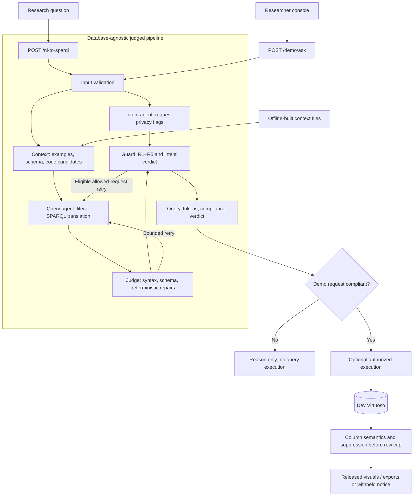
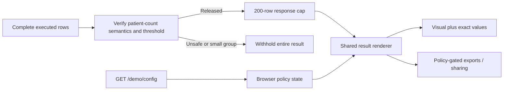

# SIB Docs

**Natural-language query translation and privacy compliance checking for Swiss Personalized Health Network (SPHN) clinical knowledge graphs.**

Neural Wave Hackathon 2026 · SIB / SPHN challenge
Docs reviewed: 17 Oct 2026 · Submission target: 18 Oct 2026, 11:00 Europe/Zurich
``` NL-to-SPARQL Gateway ```
[Quick start](#quick-start) · [Architecture](#architecture) · [Team](#team) · [Frontend handoff](docs/features/README.md) · [Validation record](docs/RESULTS_VALIDATION.md) · [CI/CD](#cicd-and-container-delivery)

---

## Contents

1. [The challenge](#the-challenge)
2. [Jury requirements](#jury-requirements)
3. [Status](#status)
4. [Architecture](#architecture)
5. [Repository map](#repository-map)
6. [Team](#team)
7. [Quick start](#quick-start)
8. [Configuration](#configuration)
9. [Infrastructure: GPU and run machine](#infrastructure-gpu-and-run-machine)
10. [Data](#data)
11. [Evaluation](#evaluation)
12. [Lessons learned](#lessons-learned)
13. [Next steps](#next-steps)
14. [Questions for the organizers](#questions-for-the-organizers)
15. [Team rules](#team-rules)
16. [Glossary and documentation](#glossary-and-documentation)
17. [CI/CD and container delivery](#cicd-and-container-delivery)
18. [License](#license)

---

## The challenge

SPHN hospitals store clinical data in RDF knowledge graphs. Researchers need an easy way to ask cohort questions **without exposing individual records**. This project provides a translator and a compliance checker behind the organizers' fixed API contract.

```http
POST /nl-to-sparql
Content-Type: application/json

{"text":"How many patients have a billed diagnosis of cholera, by sex?"}
```

| Case | HTTP status | Response |
|---|---|---|
| Compliant request | 200 | `sparql_query`, `tokens_consumed`, `is_compliant: true` |
| Forbidden request | 200 | `is_compliant: false` and `compliance_reason` |
| Invalid input | 400 | Error |
| Pipeline failure | 503 | Error |

`tokens_consumed` covers **all** model calls, including retries.

### The five privacy rules

| Rule | Prohibits |
|---|---|
| **R1** | Identifiable-patient queries |
| **R2** | Unaggregated patient results |
| **R3** | Unrestricted whole-graph matching |
| **R4** | Query forms other than `SELECT` |
| **R5** | Exposed identifiers |

Details: [guard guide](docs/GUARD.md).

**Judging** emphasizes request efficiency, compliance correctness, and generated-query performance. Token usage, model size, and memory are secondary. Only open-source models belong in the shipped system.

## Jury requirements

- Nothing reachable from `POST /nl-to-sparql` may query Virtuoso or any other database.
- Executing compliant queries is optional and belongs to development evaluation or the demo.
- The judged API may return forbidden queries for inspection; an end-user application must not expose them. `RETURN_NONCOMPLIANT_QUERY=false` controls the judged response field but does **not** replace the public-console boundary.
- Shared API fields and forbidden-request HTTP behavior must stay compatible with the organizers' specification.

> Original challenge material and restricted data are obtained privately through Santiago and must **never** be added to this repository.

## Status

| Area | Implementation and evidence |
|---|---|
| Translation and compliance | Integration, agents, context, judge, and guard implemented; historical LLM measurements in [Evaluation](#evaluation) |
| Result presentation | Metadata-driven numbers, bars, grouped comparisons, exact tables, pagination, truncation notices |
| Privacy controls | Persistent notice, configuration gating, demo-only whole-result suppression, separate public-console mode |
| Research workflow | CSV, clipboard, snapshots, hosted sharing, query-free local provenance copy; policy gates apply |
| Local verification | Last run: **810 Python, 16 Node, 88 desktop/phone browser tests passed** (local/synthetic) |
| CI/CD | Workflow configured for tests and AMD64/ARM64 delivery to GHCR; **first container build/publication still pending** |
| Real-data verification | Console comparisons, translation, and reference-result checks **PENDING** against authorized live services |

> **Caveat:** Implementation is not a guarantee of clinical correctness or regulatory compliance. Suppression limits disclosure within a result; it does not prevent inference across repeated queries. See [privacy review](docs/PRIVACY_REVIEW.md) and [validation evidence](docs/RESULTS_VALIDATION.md).

## Architecture



The database branch is used **only** by `/demo/ask` and authorized evaluation tooling. The judged endpoint returns directly from the database-agnostic pipeline.

**Pipeline notes**

- Intent checking runs alongside query generation.
- Judge and guard each have a bounded retry allowance.
- Forbidden intent and request-level identifier violations are **never** retried.
- A broken query cannot be marked compliant.
- All parsing goes through `nl2sparql.sparql.parse.parse_sparql`, including demo result processing.

### Result display



- Single-count exact values are collapsed under **Show exact value**; chart results keep the source table.
- Missing comparison combinations remain missing.
- Unsupported or ambiguous shapes stay tables.

See the [frontend contract](docs/FRONTEND.md) and [design specification](docs/specs/2026-10-16-nl-to-sparql-design.md).

## Repository map

| Path | Purpose |
|---|---|
| `src/nl2sparql/` | API, pipeline, agents, context, guard, judge, demo processing, sharing |
| `frontend/` | Researcher console, policy controller, shared renderer, preview fixtures |
| `data/` | Approved committed context snapshots and example banks |
| `eval/` | Labeled evaluation sets, reference checks, analysis tooling |
| `tests/` | Python and Node tests; Playwright harness in `tests/browser/` |
| `scripts/` | Context builders, run-machine helpers, CI boundary and container smoke checks |
| `infra/virtuoso/` | Authorized development/performance database setup |
| `docs/` | Topic guides, handoffs, validation evidence, plans, operating handbook |
| `.github/workflows/` | Project CI/CD automation |

## Team

Module ownership is documented below, distinguishing implementation contributions from operational coordination. Submission artifacts without a recorded individual owner require team assignment.

| Member | Module / role | Responsibilities |
|---|---|---|
| **Santiago Figueroa Luchetti** | Architecture · B (agents/models) · C (data/context) · run-machine coordination | Model/prompt evaluation, authorized context assets and database access, live service configuration, reference/NL verification, run-machine evidence; organizer questions and repository/package access |
| **David García Costa** | A: integration | API/orchestrator/factory/configuration, timeouts and retries, clean installation, HTTP contract, deployment integration, load-test verification |
| **Adrika Pradhan** | D: judge · context hardening · console features and automation | Judge/parser diagnostics and repairs, context loader/retrieval validation, result/policy/export/sharing/provenance implementation and regression coverage, CI/CD implementation and handoff |
| **Gayathri Girish** | D: compliance guard | Guard R1–R5, provenance/identifier checks, decision logic, regression coverage, review of policy-sensitive changes |
| **Odinaka Ogbujiagba** | E: frontend/demo | Frontend/demo ownership, interaction and accessibility review, responsive/theme presentation, demo rehearsal, coordination on result-renderer changes |

**Shared interfaces:** changes to [`models.py`](src/nl2sparql/models.py) and [`agents/base.py`](src/nl2sparql/agents/base.py) require team agreement. Coordinate cross-module work with the owner before merging.

## Quick start

**Requirements:** Python 3.11+, Git, Node.js 22 (frontend tests). Browser tests need Chromium; container tests need a running Docker engine. No GPU or Virtuoso is needed for unit tests and browser previews.

```bash
python3 -m venv .venv
source .venv/bin/activate
python -m pip install -r requirements.txt
cp .env.example .env
python -m pytest -q
NL2SPARQL_BACKEND=stub python -m nl2sparql --host 127.0.0.1 --port 8080
```

| URL | Purpose |
|---|---|
| `http://127.0.0.1:8080/?mock=1` | Synthetic console features, no database queries |
| `http://127.0.0.1:8080/` | Live demo path |
| `http://127.0.0.1:8080/agents` | Developer diagnostics |

Stub agents support wiring checks only; they do not reliably translate new questions. The live `/demo/ask` path still attempts Virtuoso execution even with stub agents.

```bash
curl -fsS http://127.0.0.1:8080/health
curl -sS http://127.0.0.1:8080/nl-to-sparql \
  -H 'Content-Type: application/json' \
  -d '{"text":"How many patients have a billed diagnosis of cholera, by sex?"}'
```

<details>
<summary><b>Troubleshooting: <code>No module named nl2sparql</code></b></summary>

Activate the intended virtual environment and rerun `python -m pip install -r requirements.txt` from the repository root (the requirements include the editable install). Alternative: `PYTHONPATH=src python -m nl2sparql`.

</details>

## Configuration

[`.env.example`](.env.example) is the complete template. Copy it, edit private values, then load it explicitly for a real-service run:

```bash
set -a
source .env
set +a
python -m nl2sparql --host 127.0.0.1 --port 8080
```

<details>
<summary><b>Settings reference</b></summary>

| Setting | Purpose |
|---|---|
| `NL2SPARQL_BACKEND` | `stub` for stand-in agents; `llm` for configured open-source models |
| `LLM_BASE_URL`, `LLM_API_KEY`, `LLM_QUERY_MODEL` | Model connection and query model; keep credentials private |
| `LLM_INTENT_MODEL`, `LLM_INTENT_BASE_URL`, `LLM_INTENT_API_KEY` | Optional separate intent model/server |
| `LLM_EXTRA_BODY` | Extra model request fields; Qwen3.x needs thinking disabled (see below) |
| `REQUEST_TIMEOUT_SECONDS`, `LLM_TIMEOUT_SECONDS`, `MAX_RETRIES` | Request/call limits and bounded checker retries |
| `RETURN_NONCOMPLIANT_QUERY` | Judged API query visibility; hackathon default `true` |
| `VIRTUOSO_ENDPOINT` | Authorized demo/evaluation database only |
| `DEMO_MIN_GROUP_SIZE` | Unset, blank, or `disabled` turns suppression off; otherwise a positive integer |
| `DEMO_PUBLIC_MODE` | Separate end-user process; requires a positive threshold and blocks developer/judged routes |
| `DEMO_DATASET_NAME`, `DEMO_DATASET_VERSION`, `DEMO_DATASET_DESCRIPTION` | Explicit dataset provenance; trimmed blank values become null |
| `DEMO_SHARE_TTL_SECONDS`, `DEMO_SHARE_DB_PATH` | Hosted aggregate-share expiry and private local storage |
| `NL2SPARQL_DATA_DIR`, `NL2SPARQL_ASSETS_DIR`, `NL2SPARQL_LOG_PATH`, `NL2SPARQL_REPORTS_DIR` | Local context, restricted assets, logs, evaluation paths |

`GET /demo/config` exposes only threshold, row limit, and policy version. Failure gates imports, exports, and cached numeric display. Dataset identity must be configured explicitly; it is never inferred from an endpoint or database patient count.

</details>

## Infrastructure: GPU and run machine

### The LLM on the GPU

The recorded setup uses **Qwen/Qwen3.5-9B** via a vLLM OpenAI-compatible server. This is an existing team setup, not a service started by installation or CI. Only open-source models may be shipped.

```bash
export LLM_EXTRA_BODY='{"chat_template_kwargs": {"enable_thinking": false}}'
```

Santiago coordinates model access and changes. Never commit tokens, host details, or private endpoints. Do not administer the GPU without authorization; read its operating guide first. See the [handbook](docs/operations/PROJECT_HANDBOOK.md#8-the-llm-on-the-gpu) and [agent guide](docs/LLM_AGENTS.md).

### The run machine

Santiago coordinates the authorized run machine. The documented setup has a **2,000-patient dev database** and a **100,000-patient performance database**. These describe the environment; they do not assert that services are currently available.

Use the [runbox documentation](docs/operations/PROJECT_HANDBOOK.md#9-the-run-machine) and [Virtuoso setup](infra/virtuoso/README.md) in an authorized session. Keep raw evaluation reports, request logs, database files, and generated terminology assets outside Git. CI neither connects to nor administers these services.

## Data

Read [docs/DATA.md](docs/DATA.md) before changing data assumptions, queries, or prompts.

- One patient = one named graph.
- Patient counts use `COUNT(DISTINCT ?g)`; returning graph identifiers exposes patients.
- The actual data profile takes precedence over assumptions from a newer schema release.

Approved context snapshots live in `data/`. Restricted terminology indexes and value sets are built locally into the ignored `assets/` directory and are never distributed in the container. See the [data/context handoff](docs/data-and-context/README.md) and [full file inventory](docs/operations/PROJECT_HANDBOOK.md#10-the-knowledge-base-and-the-data-files).

## Evaluation

> Historical run-machine measurements, kept for comparison. They do **not** validate the current checkout or newly added console features.

| Evaluation | Result | Interpretation |
|---|---|---|
| 31 shared questions, merged system (17 Oct) | **90.3%** verdict accuracy · **0** forbidden marked compliant · **3.1 / 19.2 s** p50/p95 · ~**3,700** tokens/request | Shared baseline; compare only against the matching question set |
| 198 labeled questions, fixes, run 3 | **97.3%** dev · **93.9%** holdout · **2/29** forbidden holdout requests marked compliant | Safety errors remain; don't generalize the shared set's zero-leak figure |
| Repeated fixed-system holdout runs | **87.8 / 91.8 / 93.9%** | Material run-to-run variability |
| 87 reference-query evaluation | **78%** executed · **6/87** exact reference results · **18/87** reference numbers | Execution success ≠ semantic correctness |
| 32-request load test, concurrency 8 | All HTTP 200 · **3.7 / 11.2 s** p50/p95 · **1.33 req/s** | Historical model/API load evidence |

More detail: [baseline handbook](docs/operations/PROJECT_HANDBOOK.md#11-evaluation-and-baseline-numbers), [performance log](docs/PERFORMANCE.md), [failure analysis](docs/FAILURE_ANALYSIS.md).

### Local verification

```bash
python -m pytest -q
node --test tests/frontend/*.test.cjs
npm ci --prefix tests/browser
npm exec --prefix tests/browser -- playwright install chromium
BROWSER_TEST_PYTHON="$(command -v python)" npm test --prefix tests/browser
```

### Authorized live verification

Run with private configuration loaded:

```bash
PYTHONPATH=src python eval/validate_demo_results.py --execute \
  --api-url http://127.0.0.1:8080 --browser
python eval/run_eval.py --execute
python eval/run_eval.py --intent-cases --concurrency 4
python eval/run_query_eval.py --concurrency 4
```

Keep the holdout **blind**. Record the tested commit, question set, model/prompt settings, accuracy, forbidden-marked-compliant count, latency, tokens, and sanitized evidence location. Pending checks and acceptance criteria: [RESULTS_VALIDATION.md](docs/RESULTS_VALIDATION.md).

## Lessons learned

- Parse only through the locked `parse_sparql` wrapper; rdflib is not thread-safe.
- Grouping keys can become generated SAMPLE nodes; aggregate names repeat across subqueries; unaliased grouping expressions can lose information.
- Numeric-looking category codes are categories, never inferred patient counts.
- A client timeout does not guarantee the database query stopped; partial aggregates must not be treated as complete.
- Stub success, a valid query, a successful execution, and a correct clinical answer are four different evidence layers.

Full history: [handbook](docs/operations/PROJECT_HANDBOOK.md#12-things-we-learned-the-hard-way).

## Next steps

| Area | Next action | Coordination |
|---|---|---|
| **A: integration** | Clean-install verification, final HTTP smoke checks, deployment/model-access agreement | David; Santiago for environment access |
| **B: agents** | Resolve allowed-query failures and intent false alarms; measure on dev without tuning holdout | Santiago |
| **C: data/context** | Validate current profiles/retrieval against authorized dev data; review restricted assets and server limits | Santiago; Adrika for loader/retrieval issues |
| **D: guard/judge** | Reproduce remaining failures, review guard false positives/leaks, add narrowly scoped regressions | Adrika and Gayathri; Santiago for live execution |
| **E: console/evaluation** | Complete reference/NL/browser live checks, accessibility review, demo rehearsal | Santiago for live services; Odinaka and Adrika for console follow-up |
| **CI/CD** | Run first container builds/smoke tests and GHCR publication; configure required checks and package access | Repository administrator via Santiago |
| **Submission** | Assign report/video/presentation owners; complete final release audit | Team |

See the [feature handoff](docs/features/README.md) for concrete console commands and the [historical backlog](docs/plans/PROJECT_STATUS_2026-10-17.md) for context. Reconcile historical checklist items with current code before acting on them.

## Questions for the organizers

Santiago coordinates these; the team records decisions before changing policy behavior.

- Final judging deployment and model access
- Whether semantic result correctness is scored
- Query timing, cache, and timeout methodology
- Accepted query forms
- Policy for fine-grained groups, identifying MIN/MAX, minimum sizes, and repeated-query inference
- Language and adversarial scope
- Clinical wording conventions

## Team rules

- Work on reviewed topic branches; coordinate changes across module boundaries.
- Run the full Python suite before handoff; every bug fix needs a regression test. Run applicable frontend checks for console changes.
- For pipeline behavior changes, attach matching real-model evaluation evidence or explicitly mark it as pending.
- Preserve literal translation, the fixed judged contract, database isolation, and open-source model requirements.
- **Never commit** `.env`, credentials, private GPU details, patient data, restricted terminology, generated `assets/`, or raw private logs/reports.
- Keep code, comments, and docs in English; disclose AI-assistant use in submission materials.

[AGENTS.md](AGENTS.md) and [CLAUDE.md](CLAUDE.md) stay at the repository root for coding-tool discovery, as do packaging, Docker, license, and environment-template files.

## Glossary and documentation

**RDF** stores facts as triples · **SPARQL** queries RDF · a **named graph** groups triples (here, one patient) · **Virtuoso** is the development triplestore · **SPHN** defines clinical schemas · **vLLM** serves the open-source models.

| Guide | Content |
|---|---|
| [Documentation index](docs/README.md) | Navigation across guides, plans, handoffs, historical notes |
| [Data](docs/DATA.md) | Graph conventions and schema facts |
| [Agents](docs/LLM_AGENTS.md) | Models, prompts, configuration, measurements |
| [Guard](docs/GUARD.md) · [Judge handoff](docs/guard-and-judge/README.md) | Compliance and deterministic validation |
| [Frontend](docs/FRONTEND.md) | Response contracts, visuals, exports, sharing, provenance |
| [Santiago feature handoff](docs/features/README.md) | Implemented work, configuration, remaining verification |
| [Privacy review](docs/PRIVACY_REVIEW.md) | Disclosure boundaries and limitations |
| [Validation record](docs/RESULTS_VALIDATION.md) | Actual verification and pending external checks |
| [Operating handbook](docs/operations/PROJECT_HANDBOOK.md) | Original setup, configuration, metrics, troubleshooting |

## CI/CD and container delivery

[Project CI/CD](.github/workflows/tests.yml) runs the release-file boundary, Python 3.11/3.12 suites, Node/Chromium desktop and phone checks, and non-root AMD64/ARM64 container smoke tests. **CI required checks** is the stable aggregate branch-protection gate. Synthetic tests need no clinical database, model, GPU, or private credentials.

| Trigger | Registry action after passing checks |
|---|---|
| Pull request | No publication |
| Push to `main` | Publish tested images to GHCR |
| Version tag `vX.Y.Z` or prerelease | Publish version tags; stable versions also update `latest` |
| Manual dispatch | Check-only by default; publication must be explicitly selected on an eligible ref |

- Delivery is **GHCR only**; tested platform images are promoted without rebuilding. No application server is deployed.
- Registry permissions are isolated to the publishing job via `GITHUB_TOKEN`; no PAT is required. Actions use pinned commit hashes.
- The repository administrator must permit Actions/package writes, grant package access if needed, review package visibility, protect `main` with the aggregate check, and protect release tags. Start with a manual check-only run.
- Full instructions (tags, permissions, runtime storage/networking, local builds, rollback): [container delivery handbook](docs/operations/PROJECT_HANDBOOK.md#19-cicd-and-container-delivery).

After successful publication, replace the lowercase repository placeholder:

```bash
docker pull ghcr.io/<owner>/<repo>:main
docker run --rm --publish 127.0.0.1:8080:8080 ghcr.io/<owner>/<repo>:main
```

The default image uses stub agents. Supply an authorized private environment for real services (container `localhost` is the container itself). Pin a recorded image digest for a specific delivered artifact. Mutable base images and transitive dependencies mean builds are not claimed byte-for-byte reproducible.

**Public users:** run a separate process with `DEMO_PUBLIC_MODE=true` and an organizer-approved positive `DEMO_MIN_GROUP_SIZE`, plus external authentication/TLS and appropriate private storage. **Never enable public mode on the jury's API process.** Logs and share storage need access and retention controls.

**Recorded verification:** 810 Python, 16 Node, and 88 browser tests passed locally, along with actionlint and wheel assembly. Container builds, image smoke tests, and first GHCR publication remain **pending**; local helper tests only simulate Docker transport. See the [validation record](docs/RESULTS_VALIDATION.md) before claiming registry delivery or full real-data verification.

## License

Project code is governed by [LICENSE](LICENSE). External models, datasets, ontologies, and terminology resources have their own licenses and access conditions; the project license does not grant rights to them.