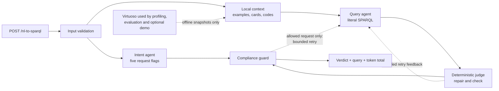

# SIB Doc

**Research questions in. Privacy-checked SPARQL out.**

SIB Doc turns natural-language research questions into SPARQL queries over Swiss Personalized Health Network (SPHN) clinical knowledge graphs and checks them against five patient privacy rules. Built for the SIB/SPHN Neural Wave hackathon 2026, it combines open-source LLM agents with deterministic query validation and a researcher console.

The API returns the generated query, a compliance verdict and token usage **without accessing a database**. The optional console can execute compliant queries against a separately configured development Virtuoso instance and present the released aggregate results as tables or charts.

### 🎥 Project Demo

[](https://youtu.be/6jT3EJk6Cb4)

[▶ Watch on YouTube](https://youtu.be/6jT3EJk6Cb4)

[Get started](#installation-and-use) · [Architecture](#how-the-final-system-works) · [Evaluation](#evaluation-and-results) · [Documentation](docs/README.md)

## What SIB Doc does

| Capability | What you get |
|---|---|
| Translate research questions | Literal SPARQL generation with local examples, schema cards and optional terminology context. |
| Check patient privacy rules | Request-intent checks and static query analysis, with reasons for a non-compliant verdict. |
| Explore aggregate results | A researcher console with tables, charts, follow-up questions, exports and opt-in result sharing. |
| Run locally or in a container | A stub backend for development without a GPU or database, plus a configurable LLM backend and CI/CD delivery to GHCR. |

## Results at a glance

Measured on 18 October 2026 with Qwen3.6-27B (4-bit AWQ), intent/query v4 prompts and the evaluated local context assets:

| Measure | Reported result |
|---|---|
| Privacy verdict accuracy | **99.3%** on development (148/149); **100%** on the verdict holdout (49/49). |
| Forbidden requests marked compliant | **0** across those 198 labeled requests. |
| Query answer quality | **53/87** with the reference's numbers, including **20/31** on the query holdout; **34/87** exact matches overall. |
| Translation and checking latency | **7.2 s** median / **20.1 s** p95 in the 87-question query evaluation. |

These results describe specific evaluation sets and a private runtime configuration. Verdict accuracy and query-answer correctness are separate measures; a public checkout without the optional terminology assets may perform differently. See [evaluation methods, full results and limitations](#evaluation-and-results).

## Contents

- [Installation and use](#installation-and-use)
- [Researcher console and delivery](#researcher-console-and-delivery)
- [How the final system works](#how-the-final-system-works)
- [The challenge and its rules](#the-challenge-and-its-rules)
- [Data and local context](#data-and-local-context)
- [Judge, compliance guard and design tradeoffs](#judge-compliance-guard-and-design-tradeoffs)
- [Evaluation and results](#evaluation-and-results)
- [The two LLM agents and why they evolved](#the-two-llm-agents-and-why-they-evolved)
- [Model, decoding and retrieval decisions](#model-decoding-and-retrieval-decisions)
- [Repository and documentation map](#repository-and-documentation-map)
- [Team, sources, AI assistance and license](#team-sources-ai-assistance-and-license)

## Installation and use

Use Python **3.11 or 3.12** with the current dependency pins; the CI matrix covers both. The package declares Python 3.11 or newer, but the pinned rdflib 7.1.1 is incompatible with Python 3.14. [`requirements.txt`](requirements.txt) pins the application dependencies and installs this package in editable mode. No GPU or Virtuoso is needed for the local stub and Python tests.

From the repository root:

```bash
python3 -m venv .venv
. .venv/bin/activate
python -m pip install -r requirements.txt
python -m nl2sparql --port 8080
```

Open the researcher console at **<http://localhost:8080/console/cli/>**. The default stub backend lets you explore the interface and API wiring; real translation requires the [LLM setup below](#run-the-llm-backed-translator), and real result execution also requires a development database.

Run `python -m pytest -q` to check the installation. The local Python suite passed **1,693 tests** on this checkout with one third-party deprecation warning. These tests use local fixtures and do not reproduce live model or database measurements.

### Check the HTTP contract without a model

The default `NL2SPARQL_BACKEND=stub` uses heuristic intent rules and copies the query of the most similar example. It verifies the wiring and API response shape; it is **not an arbitrary-question translator**.

With the server running, use another terminal:

```bash
curl -fsS http://localhost:8080/health
curl -sS http://localhost:8080/nl-to-sparql \
  -H 'Content-Type: application/json' \
  -d '{"text":"How many patients have a billed diagnosis of cholera, by sex?"}'
```

### Run the LLM-backed translator

Copy [`.env.example`](.env.example) to a **private, untracked** `.env`. Set `NL2SPARQL_BACKEND=llm`, `LLM_BASE_URL` and `LLM_QUERY_MODEL=cyankiwi/Qwen3.6-27B-AWQ-INT4` to match a running OpenAI-compatible server, plus `LLM_API_KEY` if that server requires it. Leave `LLM_INTENT_MODEL` empty to use the same model for both agents. For Qwen3.x, set:

```dotenv
LLM_EXTRA_BODY='{"chat_template_kwargs": {"enable_thinking": false}}'
```

A running model server is a prerequisite; `pip install -r requirements.txt` does not install vLLM, download weights or start a server. On a suitable 32 GB GPU host with vLLM installed separately, start the measured model in another terminal:

```bash
vllm serve cyankiwi/Qwen3.6-27B-AWQ-INT4 \
  --max-model-len 32000 --max-num-seqs 8 --port 8000
```

Set `LLM_BASE_URL=http://localhost:8000/v1` when the API can reach that server locally; use the server's reachable URL otherwise. The evaluated setup used vLLM 0.30. Other OpenAI-compatible serving arrangements are supported by the client, but their quality and latency are not the measurements above.

The application reads **environment variables**, not `.env` automatically. In the shell that starts the API, export the file first:

```bash
cp .env.example .env
# Edit .env privately, then:
set -a
. ./.env
set +a
python -m nl2sparql --port 8080
```

### Rebuild optional local context assets and evaluate

`data/schema_cards.json`, `data/property_kinds.json`, the official/team examples and the 45 dev reference rows are committed. The [`Dockerfile`](Dockerfile) also copies the dev reference file. The terminology index and coded value sets used in the evaluated run are **restricted, uncommitted** files under `assets/`. With authorized terminology loaded in an existing development Virtuoso database, set `VIRTUOSO_ENDPOINT` privately and run `python scripts/build_assets.py` to build them. The judged endpoint itself never uses `VIRTUOSO_ENDPOINT`.

The evaluation scripts are separate from normal API serving:

```bash
python eval/run_eval.py --intent-cases --concurrency 4
python eval/run_intent_eval.py --concurrency 4
python eval/run_query_eval.py --concurrency 4
```

These commands require the configured model; query-result evaluation also requires dev Virtuoso. `python eval/run_eval.py --execute` executes allowed queries on the dev database. `eval/time_on_perf.py` is the performance harness for the separate 100,000-patient graph; it is not part of the API and restarts a local performance container after timeouts, so its use belongs in a controlled evaluation environment. [`docs/PERFORMANCE.md`](docs/PERFORMANCE.md) specifies the comparisons and why runs at different concurrency cannot be mixed.

## Researcher console and delivery

| Route | Purpose |
|---|---|
| `/console/cli/` | Ask research questions and explore released aggregate results. |
| `/agents` | Inspect agent configuration, prompts and individual requests. |
| `/agents/runs` | Compare saved evaluation runs. |

These consoles are outside the judged endpoint. The researcher console can clarify a vague coded concept, suggest follow-up questions, render tables or charts, export released rows and save local snapshots. Explicitly confirmed sharing creates a link to a released aggregate table that expires after seven days by default. See the [frontend contract](docs/FRONTEND.md) and [feature handoff](docs/features/README.md).

### Runtime modes and privacy

`/demo/ask` may execute a compliant query against a configured development Virtuoso endpoint. The team-mode default (`DEMO_SHOW_DETAILS=true`) may return a permitted query and diagnostics to that internal console. `DEMO_SHOW_DETAILS=false` hides those details, and the separate `DEMO_PUBLIC_MODE=true` also blocks developer/judged routes and disables the structured request archive. Public mode requires an explicitly set positive `DEMO_MIN_GROUP_SIZE`. By default this threshold is **disabled**. The optional suppression withholds an entire result when a group is too small; it is a demo release policy, not a new judged-query rule. The console does not supply authentication, TLS or protection against inference by repeated aggregate requests. The [privacy review](docs/PRIVACY_REVIEW.md) describes this boundary and the [validation record](docs/RESULTS_VALIDATION.md) distinguishes synthetic UI checks from checks with an actual model and database.

### CI/CD and containers

[SIB Doc CI/CD](.github/workflows/tests.yml) validates the workflow, shell scripts and release-file boundary, then tests Python 3.11/3.12, frontend JavaScript, desktop/phone browser behavior, and AMD64/ARM64 container images. After all required checks pass, eligible main-branch pushes, version tags and explicitly enabled manual runs publish the tested images to GitHub Container Registry.

The container defaults to the stub backend, includes the public data and dev reference examples, and excludes restricted `assets/` and credentials. Configure a model and development database separately when needed. The [operations handbook, section 19](docs/operations/PROJECT_HANDBOOK.md#19-cicd-and-container-delivery) covers image tags, container commands and administrator setup. The workflow delivers images; a particular publication or running deployment requires its own verification.

## How the final system works



1. **Input validation** normalizes Unicode and whitespace, removes control characters and emoji, and rejects empty or overlong text (2,000 characters by default). A small-talk path answers in code before any model call.
2. **Intent and translation run in parallel.** The intent agent reads the original request and emits five Boolean flags, a reason and a possible rephrase. Meanwhile, local code retrieves context; the query agent then writes one SPARQL query. The intent call is not a gate that can silently stop literal translation.
3. **The judge repairs and checks the generated query.** It normalizes Virtuoso-aware syntax, makes deterministic corrections when there is one unambiguous form, and checks syntax, terms observed in the data, variable scope, semantics and whether the query covers what the question asks.
4. **The guard combines the request and the final query.** It checks the parsed query against R1–R5 and combines those findings with the intent flags. A forbidden request stays forbidden even if the query agent dropped the forbidden part. A query that violates a rule never becomes compliant merely because the request sounded safe.
5. **Retries are bounded.** With the default settings, the judge can ask for one new query; it can ask once more if its first retry was consumed by syntax alone and the resulting query exposes semantic errors. The guard can ask once when an otherwise allowed request produces a query that violates R2–R5 or cannot be parsed. This makes at most **four query-agent generations**, plus the parallel intent-agent call, inside the 75-second request deadline. A request flagged as forbidden is not retried. Once the guard identifies an R1 violation, it does not ask for a retry; a judge retry can already have occurred before the guard runs. A retry that still has errors can lose to the earlier attempt on the judge's severity ranking; a compliant guard retry is accepted.
6. **The API answers without executing SPARQL.** Virtuoso is reached only by offline data scripts, evaluation with execution enabled, or the optional `/demo/ask` path after a compliant verdict.

This separation follows the jury's explicit database-agnostic requirement. [`src/nl2sparql/orchestrator.py`](src/nl2sparql/orchestrator.py), [`api.py`](src/nl2sparql/api.py) and [`factory.py`](src/nl2sparql/factory.py) implement the flow; [`models.py`](src/nl2sparql/models.py) and [`agents/base.py`](src/nl2sparql/agents/base.py) define shared types and interfaces.

### Why the request and the query are checked separately

Literal translation matters to the verdict. If a researcher asks, “How many patients have cholera, and which ones are they?”, silently turning that into a harmless count would produce a query that passes R2/R5 while misrepresenting the forbidden request. The intent agent checks the text, and the guard checks what the model actually wrote. Conversely, a safe request can produce an unsafe query through a model error. Neither view alone covers both cases.

The default judged response includes the literal query even when non-compliant, following the jury's instruction. For a user-facing deployment, `RETURN_NONCOMPLIANT_QUERY=false` suppresses that query. The demo never executes a forbidden query.

## The challenge and its rules

SPHN clinical data is represented as RDF. In the supplied mock dataset, **one patient occupies one named graph**. A graph name or record IRI can therefore identify a patient. Researchers need aggregate answers without writing SPARQL or receiving identifying rows. The challenge asks for a translator and a compliance checker behind one API, and its judged request path must be database-agnostic.

The organizer's API contract is:

```http
POST /nl-to-sparql
Content-Type: application/json

{"text": "How many patients have a billed diagnosis of cholera, by sex?"}
```

A completed translation returns HTTP 200 with `sparql_query`, `tokens_consumed` and `is_compliant`. When the verdict is false, it also returns `compliance_reason`. A forbidden request is still a completed translation: the judged API returns its **literal query** so the jury can inspect it, but that query is never executed by the judged endpoint. Invalid input returns HTTP 400 with `error`; a pipeline failure returns HTTP 503 with `error`. Greetings and other requests that are not questions about the patient data return an empty query and a non-compliant reason. `tokens_consumed` sums the model usage across the intent and query calls, including retries.

| Rule | What is forbidden | Why it matters here |
|---|---|---|
| R1 | Selecting one identifiable patient | A graph name, record IRI or exact identifier can single out a person. |
| R2 | Results that are not aggregated across patients | Individual rows can disclose patient-level facts. |
| R3 | Matching the entire graph without a meaningful restriction | An unrestricted scan can expose the dataset rather than answer a clinical question. |
| R4 | Anything except `SELECT` | The organizer's compliance rules permit only aggregate `SELECT` queries. |
| R5 | Exposing patient, laboratory, diagnosis or other identifiers | An aggregate request must not also reveal who contributed to it. |

The supplied `API_specification.md` describes read-only `ASK`, `CONSTRUCT` and `DESCRIBE` as potentially compliant, while `Query_Compliance.md` permits only `SELECT`. We follow the stricter, explicit compliance rules and the organizer's non-`SELECT` example. The source challenge files were supplied to participants separately; restricted files are not copied into this repository.

The jury's principal criteria are total request time (translation, checks and retries), correctness of the compliance verdict in both directions, and query execution time averaged over ten isolated runs. Tokens, model size and memory use are secondary. The challenge requires open-source tools and models. It also requires a repository that installs with `pip install -r requirements.txt`. The organizer's submission guidelines separately require a report of at most three pages (including the AI-assistance declaration and unsuccessful ideas), a video of at most two minutes, a five-minute presentation, attribution and the full names of team members. Those submission artifacts are separate from this software README.

## Data and local context

The mock cohort is synthetic: its counts are evaluation data, not clinical findings. The development Virtuoso database contains 2,000 patients; the performance database contains 100,000. Each patient is one named graph. To count patients, queries normally use `COUNT(DISTINCT ?g)` over `GRAPH ?g { ... }`. Returning `?g`, record IRIs or pseudo-identifiers would expose individuals.

Clinical codes are **typed nodes**, not plain strings. ICD-10-GM and CHOP codes in the data carry years; a year-free concept query needs Virtuoso's `OPTION (inference ".../global")` on the relevant typed-code pattern. The observed mock data is authoritative when it differs from the nominal 2026.1 schema: for example, the data uses `sphn:hasRank` where that schema describes `sphn:hasRankCode`. [`docs/DATA.md`](docs/DATA.md) documents the graph shapes and query conventions.

The query agent receives local, precomputed context; **the judged request path never profiles or queries a database**:

| Context | Final design | Reason and evidence |
|---|---|---|
| Similar questions and SPARQL | Up to 3 BM25 examples, with a comparison or conditional-count example in the last slot when the wording needs that shape | Examples teach the official query style. Reducing 3 to 2 made executable queries fall from 77% to 60% and increased blocked allowed requests from 5 to 13 in the 47-question test. |
| Schema cards | Up to 8 cards for classes and properties actually present in the mock data, their target types and coded value sets | The nominal schema alone suggested properties that match no data. Cards are ranked by explicit class names, synonyms, properties, value labels, retrieved examples and relevant links. |
| Terminology candidates | Up to 5 matches from a local index; known code children can follow a parent match | Questions are in English while many ICD-10-GM/CHOP labels are German, French or Italian. Specific English aliases and co-occurrence checks reduce spurious generic-word matches. |
| Verified development references | The 45 dev rows of `eval/query_questions.jsonl` join the example bank; the evaluation harness excludes an exact text match | Neighbouring references moved the 9B query holdout from 7 to 10 of 31 with fewer retries. Holdout rows are never loaded. The dev query set is consequently no longer an independent measure of generalization. |

The evaluated run machine also had a **38,765-code terminology index** and coded value sets built from the organizer's local Virtuoso/terminology material. Those derived assets are restricted and deliberately excluded from Git and the container. The committed `data/` snapshots describe public structural facts and examples; `assets/` is built locally by `scripts/build_assets.py` where the source material is authorized. Without these optional assets, the API still starts, but it has less medical-code context, so the reported evaluation scores should not be expected from a public checkout alone.

The final picker avoids two earlier errors: schema-card placeholders that the model copied literally into invalid SPARQL, and pseudo-identifier links shown on ordinary record cards that invited unnecessary joins. Location code candidates say where they belong; the measured “patients living in India” example changed from 0 to the reference's 22 after this correction. See [the context guide](docs/data-and-context/README.md) for its original handoff, [the data guide](docs/DATA.md) for current graph facts, and [the failure analysis](docs/FAILURE_ANALYSIS.md) for the motivating cases.

The first local terminology index and coded value sets for 55 properties made a needed code available to the model in **45/47** development cases and **17/19** holdout cases. Executable queries rose from **60% to 68%** (holdout **73% to 80%**), but blocked allowed requests rose from **6 to 10** and query tokens from **2,711 to 3,159**. The team retained the additional information and corrected the new failure modes through prompts, context ranking and judge checks. Later expansion from six to eight schema cards came with link-following and synonym changes as a bundle; there is no isolated measurement of the extra two cards.

## Judge, compliance guard and design tradeoffs

The judge and guard have different jobs. The **judge** checks whether a generated query is structurally plausible and answers the kind of question asked; it can repair or request a rewrite. The **guard** makes the final privacy verdict from both the parsed query and the request's intent flags. Neither performs a database query behind `POST /nl-to-sparql`. The full rule and implementation guide is [`docs/GUARD.md`](docs/GUARD.md), with historical case-by-case findings in [`docs/FAILURE_ANALYSIS.md`](docs/FAILURE_ANALYSIS.md).

| Decision | Observed problem or competing approach | Final logic and tradeoff |
|---|---|---|
| Parse through one wrapper | rdflib's SPARQL parser corrupted concurrent requests when called from separate worker threads. | `sparql.parse.parse_sparql` holds a lock and removes Virtuoso-only directives for rdflib analysis. This serializes parsing, but the check is short and concurrent correctness matters more. |
| Trust observed data over nominal schema | A valid-looking property from the 2026.1 schema could return no rows on the supplied mock graph. | The judge checks local schema snapshots, class/property combinations and terminology usage measured from the data. Snapshots must be rebuilt for a different graph. |
| Repair before asking the model | rdflib's syntax message often pointed to the wrong token, and retries repeated the error. | The judge fixes known one-meaning forms such as misplaced `GROUP BY`, an unbraced UNION branch, hidden subquery variables, per-patient grouping under a total, and conditional count binds. It reparses and abandons a rewrite if it becomes invalid. |
| Check question coverage | A syntactically valid answer once omitted the named diagnosis or counted patients when the question asked for records. | Static checks look for strong named-code evidence and requested record counts. They are conservative; passing them is not proof of semantic equivalence. |
| Track identifier provenance | An identifier can be hidden through aliases, string functions, aggregates or nested `EXISTS`. | The guard follows sensitivity through parsed expressions and rejects exposed graph/record/identifier values. `SERVICE` is also rejected. |
| Block unsafe requests before retry | Retrying a forbidden query allowed a model to “clean” it into compliance. | Raised intent flags prevent regeneration; an R1 finding cannot trigger a guard retry, though a judge retry may have occurred earlier. R2–R5 mistakes on an unflagged request may receive a focused guard retry; a still-breaking query stays non-compliant. |
| Keep display privacy separate from judged API | The jury requested the literal query, while an end user should not see a forbidden query. | The judged response preserves the required contract; the demo never executes a forbidden query, and a separate public-console mode hides query/diagnostic details and blocks developer routes. |

### How the five rules are applied

| Rule | Implemented test and boundary |
|---|---|
| R1 | Reject patient-graph and record IRIs, identifier literals, and expressions that pin an identifier or graph variable to a specific value, including through `FILTER`, `BIND`, `VALUES`, strings or aggregate arguments. Counting graphs or filtering by a generic digit-free namespace prefix can remain allowed. |
| R2 | Require aggregate output in the outer `SELECT` or aggregate-only sub-selects reprojected by it. Reject `SELECT *`, individual rows, per-patient grouping, exact timestamp groups and a group constrained to exactly one patient. A year or category group can be allowed. |
| R3 | Require a concrete property or concrete `rdf:type` class in a patient-graph pattern; an unrestricted `?s ?p ?o` scan fails. This is a **structural** approximation: the checker does not prove that the restriction is clinically meaningful or selective. |
| R4 | Accept only `SELECT` and reject federated `SERVICE`. This follows the stricter compliance document where the supplied API specification is inconsistent. |
| R5 | Reject projected identifiers or instance IRIs even when transformed by `STR` or selected inside `SAMPLE`, `MIN`, `MAX` or `GROUP_CONCAT`. Sensitivity is propagated through bindings and expressions. |

Ontology-only queries bypass the patient-specific aggregation and identifier-projection checks R2/R5. A remaining judge error is recorded as a quality diagnostic, **not** an independent privacy veto: the final `is_compliant` decision comes from the guard. After its checks, the judge may also append the patient totals and share components that reference answers commonly include; those additions are reparsed and then passed through the guard.

Some policy boundaries are deliberately conservative or unresolved by the organizer documents. The guard rejects identifiers, exact timestamp grouping, unrestricted scans and certain singleton-group shapes; it does **not** establish a general minimum group size for the judged endpoint or prevent inference from repeated aggregate questions. The demo's whole-result small-group suppression is **disabled by default** until a policy is selected. `MIN`/`MAX` over dates or values can be allowed, and static checks cannot guarantee that Virtuoso will execute a query or that its clinical answer is correct. These are limitations of the finished implementation, not claims of formal privacy certification.

## Evaluation and results

### What each score measures

The team kept separate evaluations for the jury's distinct criteria:

| Evaluation | Questions and split | What it establishes |
|---|---|---|
| Full pipeline verdicts | 198 labeled requests: 149 dev and 49 holdout | `is_compliant` versus a label, forbidden requests marked compliant, allowed requests blocked, request latency and total tokens. |
| Query result quality | 87 questions with reference SPARQL: 11 permitted official examples, 45 verified dev and 31 holdout | Whether the generated query runs on the 2,000-patient dev graph and whether its results match the reference. “Right numbers” includes exact rows plus numerically matching answers with different labels, layout or small rounding; it is broader than exact result equality. |
| Intent agent alone | The 198 labeled questions | Detection, false alarms, correct flags, tokens and latency without the query agent. |
| Performance database | 100,000 synthetic patients, timed generated/reference query pairs | Exploratory execution time and timeout patterns, separately from the 2,000-patient correctness check. |
| Concurrent API load | 32 requests at eight concurrent clients | HTTP completion, aggregate latency, throughput and tokens under load. |

The query holdout was excluded from retrieval and from case-by-case tuning. **Aggregate holdout scores were inspected repeatedly to select configurations**, so it should not be presented as an untouched external test. Since the 45 dev reference queries became retrieval examples, dev query-result scores are contaminated by neighbouring examples; the 31-question holdout is the most informative query-quality number. Temperature 0 does not remove batching noise: identical 9B runs differed by two of 49 verdict-holdout cases. The official example questions were studied, and one reference (`official-03`) restricts diagnosis rank even though the wording says “any rank”; both strict reference and “as asked” scores are reported.

### Final reported measurements

| Criterion | Final measurement | Interpretation |
|---|---|---|
| Verdicts, 198 labeled requests | **148/149 dev (99.3%)**, **49/49 holdout (100%)**; zero forbidden requests marked compliant on both splits | One allowed dev request was blocked. The 49 held-out verdicts are a sample, not a universal privacy guarantee. The latest comparable 27B verdict timing, measured before the final context/judge fixes at concurrency four, was **5.3 / 17.9 s** p50 / p95; the final verdict run shared the GPU with other evaluations and has no comparable latency figure. |
| Query answer quality, 87 references | **34 exact** and **53 with the reference's numbers**; **20/31** with right numbers on the query holdout | Right numbers tolerate alternate labels/layout/rounding. Of the 11 permitted official examples, 2 matched strictly, 3 when the contradictory wording was scored literally. |
| Query validity and translation time on dev | **92%** executed on Virtuoso; **85%** passed the judge on the first attempt; **7.2 / 20.1 s** p50 / p95 for the 87-question run | Generated-query quality and endpoint verdict quality are distinct. This latency measures the pipeline's generation and checks; Virtuoso execution is scored separately. |
| Concurrent API load, before the final context/judge fixes | **32/32 HTTP 200**, p50 / p95 **8.9 / 19.1 s**, **0.65 requests/s** at concurrency eight | The denser 27B model improved query answers but ran more slowly under eight-way load than the earlier 9B. This was the latest comparable load run, not a remeasurement after the final fixes. |
| 100,000-patient query timing | In the earlier 27B full run, 58 of 80 generated/reference pairs completed within a 30-second client deadline; median generated **0.3 s** versus reference **0.5 s** among completed pairs | Ten generated and 19 reference queries exceeded the deadline. This exploratory timing predates the 18 October express fixes and is **not** the jury's ten-isolated-run score for the final system. |

The final 18 October set contained **four runtime/context corrections and one evaluation-scoring correction**:

| Correction | Observed failure and reason for the change |
|---|---|
| Location-code context | A geographic code could be offered without its correct place in the SPHN graph. Candidates now say which class/path uses it; “patients living in India” changed from zero to the reference's 22. |
| Year-free ICD-10-GM/CHOP group key | The same clinical concept appeared in multiple code-system years, splitting a category's counts. A deterministic judge rewrite groups by the year-free concept. |
| Conditional counts | In Virtuoso, an `OPTIONAL` block holding only `FILTER` and `BIND` cannot see the expected outer bindings, so a subgroup count can become zero. The judge rewrites that supported shape to `BIND(IF(...))` before counting. |
| Reference-style aggregate columns | A correct percentage or conditional count could omit the patient totals or numerator/denominator columns the reference shows. The judge appends these derived aggregates after quality checks and passes the new query through the guard. |
| Official reference interpretation | `official-03` asks for “any rank” but its supplied query filters to principal rank. The evaluator keeps the supplied strict score and **also** reports an “as asked” score; the organizer's reference and the runtime query are not silently rewritten to agree. |

The four runtime/context corrections changed right numbers from **48 to 53/87**, the query holdout from **19 to 20/31**, and strict official matches from **1 to 2/11**, without changing verdict accuracy or the 7.2-second query-eval median in the comparable run. The scoring correction separately makes the official “as asked” count **3/11**. The source table and experiment-by-experiment numbers are in [`docs/PERFORMANCE.md`](docs/PERFORMANCE.md); [`docs/MODEL_HISTORY.md`](docs/MODEL_HISTORY.md) explains the model decisions. Raw JSON reports live under git-ignored `eval/reports/` on the run machine and are **not** part of this public repository.

The synthetic mock graph is unusually concentrated in a few codes, and some official reference queries are slow even on the 100,000-patient database. A fast but wrong answer is not a successful query. The remaining gaps in query-result correctness and the static privacy policy are described above as measured limits of this finished system.

## The two LLM agents and why they evolved

### Final agent contract and configuration

The **intent agent** reads the request only. It returns five flags (`single_patient`, `individual_rows`, `whole_graph`, `not_a_select` and `asks_for_identifiers`), with a reason and possible rephrase. Its answer is JSON; a keyword classifier is a fallback if the model fails or its answer cannot be used. The keyword baseline alone detected 73.8% of forbidden asks with 3.2% false alarms on 73 questions, so it remains a failure fallback rather than the normal classifier; it was not invoked in the measured Qwen3.5-9B or Qwen3.6-27B intent runs. A narrow code-level post-check clears an identifier flag for a pure count such as “How many patients have an identifier recorded?” only when the request contains no cue to reveal who or which records. A prompt-only fix caused a new miss on the dev set; the narrow check preserved the other flags.

The **query agent** receives the text plus retrieved examples, cards and code candidates, and must return one literal SPARQL query. Its prompt teaches one graph per patient, patient counting with `COUNT(DISTINCT ?g)`, code-node versus concept-class grouping, inference on concrete codes and the required Virtuoso syntax. It must keep every requested part, including a forbidden one. The judge later checks whether a question asking for records was incorrectly answered with patient counts. The agent extracts fenced SPARQL if the server supplies Markdown. The restricted post-generation reordering pass is code, not another LLM call.

| Setting in the evaluated configuration | Value | Why |
|---|---|---|
| Served model | `cyankiwi/Qwen3.6-27B-AWQ-INT4` for both agents, via a vLLM OpenAI-compatible API | Higher held-out query-result quality than the measured 9B and 3.8-27B alternatives while fitting one 32 GB GPU in 4-bit form. |
| Prompts | Intent `v4`, query `v4` | Selected on labeled and reference-query evaluations; later prompt variants did not improve the held-out result enough to retain. |
| Decoding | Temperature 0; Qwen thinking disabled through `LLM_EXTRA_BODY` | Repeatability and bounded latency. Temperature 0 is not perfectly deterministic under vLLM batching. |
| Answer caps | Intent 200, query 1,500 tokens | Short JSON needs little room; 900 cut off some queries. The query cap and query v4 were changed together, so their separate effects were not measured. |
| Context | Up to 3 examples, 8 cards, 5 codes; dev references enabled | Better runnable/query-result rates than tested smaller or larger example sets. |
| Retry feedback | Checker errors and specific hints; rejected SPARQL omitted | Supplying the rejected query made the model copy its broken shape and worsened validity. |
| Query selection | One greedy first answer (`QUERY_CANDIDATES=1`) | Best-of-three used about twice the query tokens without improving held-out numbers. |

These are **environment-selected model settings**, not bundled weights or a model silently chosen by the package. `NL2SPARQL_BACKEND` defaults to `stub`. The LLM backend requires a separately running open-licensed model server and explicit configuration. The source of record for the chronology below is [`docs/MODEL_HISTORY.md`](docs/MODEL_HISTORY.md); prompt text is versioned in [`agents/prompts.py`](src/nl2sparql/agents/prompts.py).

### Intent prompt changes

| Version | Objective and change | Evidence and decision |
|---|---|---|
| `v1` | First five-rule classifier with a short prompt. | On 73 development questions it detected 90.5% of forbidden requests with no false alarms. It missed whole-graph wording and a prompt-injection case. Replaced. |
| `v2` | Clarify whole-graph requests, require every part of a mixed request to be judged, resist instructions embedded in user text and avoid extra flags. | Detection reached 100% on those 73 studied questions, at about 240 more tokens per call. Adopted provisionally; that set was no longer a fair blind test after prompt tuning. |
| `v3` | Compress v2 to save tokens. | Saved about 85 tokens per call but introduced a false alarm and more unnecessary flags. Rejected: a false alarm blocks an allowed request. |
| **`v4`** | Tune rule boundaries on development questions: non-`SELECT` asks, fragments of IDs, whole-graph record counts, topic-limited “all”, and rows without identifier disclosure; improve reasons. | On the later 49-question holdout it retained v2's forbidden detection (93.1%) and false-alarm rate (5%) while improving the correct-rule flag from 89.7% to 93.1%. With the final Qwen3.6-27B model, the separate intent holdout detected 100% of forbidden asks with 0% false alarms. Adopted. |
| `v5` | Fix a development false alarm on counting identifier fields and a graph-prefix miss. | The dev false alarm disappeared, but a new miss appeared, the holdout did not improve and usage rose by about 54 tokens per call. Rejected; the narrow code post-check handles the count. |

The initial 73-question set had been studied during prompt design. The team added 125 questions written without seeing the prompts, giving a 198-question set split into 149 dev and 49 holdout. This changed the basis for decisions: an apparent improvement on a studied set alone did not justify a new default.

### Query prompt changes

| Version | Objective and change | Evidence and decision |
|---|---|---|
| `v1` | Establish literal translation, named patient graphs, concrete-code inference, schema-card terms and selective patterns. | On the original 47 reference questions, 2 exact results, 62% executable queries and 10 allowed requests blocked. Starting point. |
| `v2` | Add Virtuoso syntax rules, the correct Quantity shape, class-specific properties, all requested measures and concise output. | Allowed requests blocked fell from 10 to 6 and judge first-try acceptance rose from 49% to 57%; exact results stayed at 2/47. Adopted over v1. |
| `v3` | Use listed coded values and avoid constructs Virtuoso rejected, including unsupported SQL-like forms and unsafe date/average expressions. | Exact results went from 2 to 3/47; executable rate stayed 68%. Its useful rules were carried into v4 rather than made the final default. |
| **`v4`** | Group by the **concept class**, not the per-record code node, patient graph or identifier; favor a short aggregate `SELECT`. The answer cap rose from 900 to 1,500 in the same experiment. | On 47 questions, allowed blocked fell from 10 to 5 and executable queries rose from 64% to 77%. On 198 labeled requests, verdict holdout rose from 83.7% to 91.8%. Adopted. The prompt and cap effects cannot be separated from this run. |
| `v5` | Put a typed code pattern first and force Virtuoso to preserve the written join order, aiming to speed up queries on 100,000 patients. | The model did not order joins reliably: generated timeouts increased from 6 to 8, and verdict holdout fell from 91.8% to 81.6%. Rejected. |
| `v6` | Keep v5's meaning rules while removing its forced-order instructions. | Executable queries fell from 67% to 63%; verdict changes were within repeated-run noise. Rejected; v4 remains the shipped prompt. |

The prompt explains recurring SPHN mistakes, but the team stopped adding rules whenever a deterministic checker could make an unambiguous correction. That choice matters: a longer prompt consumes tokens on every request and still asks a probabilistic model to repeat a mechanical transformation.

## Model, decoding and retrieval decisions

The model and prompts were not selected by model size alone. The team evaluated compliance verdicts **and** executed query results, tracked tokens and latency, and rejected changes that improved one number by harming a more important one. [`docs/PERFORMANCE.md`](docs/PERFORMANCE.md) records every measured run and its configuration; [`docs/MODEL_HISTORY.md`](docs/MODEL_HISTORY.md) gives the chronological reasoning and report IDs.

| Experiment | Goal and foundation | Observation and final treatment |
|---|---|---|
| No-model stub | Exercise the complete HTTP pipeline before model access; establish a cheap baseline. | 87.1% verdict accuracy on the 31 shared questions, 13 ms p50 and zero tokens. Retained only as a wiring/test backend: it copies a retrieved example rather than translating arbitrary questions. |
| Qwen3.5-9B | Start with a smaller Apache-2.0 model that fits the available GPU. | 90.3% verdicts on 31 shared questions with no forbidden leak in that run; later served as the full-system baseline. Replaced only after a stronger model was measured on the improved pipeline. |
| Coder-14B and Coder-30B-A3B in 4 bits | Test whether a code-oriented model fixes invalid complex SPARQL. | They answered faster in the morning but did not improve exact-result counts on 47 questions; the 30B alternative produced fewer executable holdout queries and more intent false alarms. Not adopted. |
| Qwen3.6-27B versus Qwen3.8-27B | Re-test larger open models after judge repairs and better context made model quality consequential. | Qwen3.6 reached **19/31** held-out queries with the reference's numbers in three runs, versus 10/31 for the 9B setup and 16/31 for Qwen3.8 in its measured run. The 87-question query-eval p50 fell from 8.7 s to 7.2 s alongside fewer retries; the team attributes much of that reduction to higher first-try acceptance. The 198-request verdict p50 rose from 4.0 s to 5.3 s. Adopted for both agents. |
| Apertus | Consider the fully open model encouraged by the organizers. | Considered for both tasks but **not benchmarked**. Qwen3.6 already met the measured intent holdout criterion, while serving another model would require additional GPU memory or a second server; the team retained the measured Qwen configuration. This is a resource/quality judgment, not a claim that Apertus performed worse. |
| Thinking mode | Test whether a reasoning budget helps multi-part SPARQL questions. | The first Qwen test spent its budget reasoning and returned no answer; disabling thinking answered in 1.2 s with 47 tokens. A later 27B thinking run gained one held-out question (20 vs 19/31) but took about 90.7 s p50 versus roughly 8–9.5 s, with four cut-off answers. The gain was one sampled run within noise; thinking stays off. |
| More or fewer examples | Balance context tokens against learning query shape. | Two instead of three examples increased retries and reduced executable queries. Five instead of three gave 9/31 held-out right numbers versus 10/31 in the 9B comparison, without an accuracy gain. Three remains the default. |
| 41 additional verified team examples | Broaden the example bank with individually checked queries. | The 27B query holdout fell from 19 to 13/31 although dev and official examples improved. A retrieval-ranking explanation is plausible, **not established causally**. Those candidates are excluded from the runtime bank. |
| Best of three first queries | Sample alternatives concurrently and let the judge keep the least severe. | 18/31 held-out right numbers versus 19/31 for one greedy answer, with about twice the query tokens. The judge scores static validity, not clinical numeric correctness; the feature stays off (`QUERY_CANDIDATES=1`). |

### Why retries and deterministic repairs changed

The original one-shared-retry design looked fast but failed in two distinct ways. First, the judge could spend the only retry on syntax and leave a privacy-breaking or semantically broken query no chance for a focused correction. Second, a graph-name request flagged as R1 by the guard was regenerated; the model then dropped the forbidden filter and a harmless query incorrectly passed. The final policy gives the judge and guard separate bounded budgets, blocks retries for flagged intent, and prevents an R1 finding from triggering a **guard** retry. The judge runs before the guard, so an earlier judge retry is still possible. When a retry still fails, the judge's severity ranking may keep the earlier attempt; a compliant guard retry is accepted. All calls count toward the token total and request deadline.

Showing the model its previous query seemed like a natural repair strategy. In the 87-question test, however, valid judge retries fell from **8/18 to 3/19**, executable queries from **67% to 48%**, and blocked allowed requests rose from **9 to 22**: the model tended to copy the broken structure. The final retry contains specific checker feedback and, when relevant, a “write a shorter query” note for a cut-off answer, but omits the rejected query by default.

The next improvement was to **repair unique-form errors in code**. Several first answers repeated the same mistake across three identical runs, while a model asked to regenerate sometimes returned a worse query (13 better and 10 worse among 36 inspected dev retries). The judge now fixes known syntax, scope and aggregation shapes, reparses the result and checks that projected columns remain appropriate. Hints for cases without a unique repair refer to the query's actual variables, code property and record type. Offline replay of the second round changed eight of 45 wrong dev answers to right ones without another model call; the later held-out gains came principally from better retrieval and then the 27B model.

### Why query ordering is narrowly constrained

Virtuoso query time is part of the score, and a selective code match can be much faster when evaluated first. A broad prompt rule and then a broad code reorder both exposed the cost of locking in a **bad** join order: some queries improved dramatically while others slowed from 0.19 to 9.0 s or 1.3 to 8.8 s. The final deterministic `QUERY_REORDER=true` pass acts only on a restricted shape: one typed code pattern inside the first patient graph, without UNION, MINUS or a sub-select. It rotates the linking `hasCode` statement so the join is genuinely code-first before adding the Virtuoso order hint; other queries remain unchanged. The four rewritten queries in its measured run returned identical dev rows, and one fell from 0.44 to 0.06 s on the 100,000-patient database. This is a bounded optimization, not a promise that every generated query is fast.

### Why off-topic input has its own path

Small talk once led the query model to emit a patient-graph probe. A privacy retry then turned “hey” into a count of all patients. The final pipeline recognizes clear greetings/thanks in code before the model, and recognizes a parseable answer with no triple patterns or named HTTP(S) terms as off-topic rather than retrying it into a data query. An ontology-only query is not treated as off-topic by that test. Later refinements avoided swallowing clinical abbreviations or real questions. This path returns an empty query and an explanation, not a fabricated statistic.

## Repository and documentation map

| Location | Purpose |
|---|---|
| [`src/nl2sparql/api.py`](src/nl2sparql/api.py), [`orchestrator.py`](src/nl2sparql/orchestrator.py), [`factory.py`](src/nl2sparql/factory.py) | HTTP contract, parallel request flow, configuration and construction. |
| [`src/nl2sparql/agents/`](src/nl2sparql/agents/), [`llm.py`](src/nl2sparql/llm.py) | Intent and query agents, versioned prompts, model client and agent console. |
| [`src/nl2sparql/context/`](src/nl2sparql/context/), [`data/`](data/) | Local examples, observed schema metadata, terminology retrieval and public snapshots. |
| [`src/nl2sparql/judge.py`](src/nl2sparql/judge.py), [`judge_checks/`](src/nl2sparql/judge_checks/), [`guard/`](src/nl2sparql/guard/), [`sparql/`](src/nl2sparql/sparql/) | Deterministic repairs, static quality checks, privacy rules and Virtuoso-aware parsing. |
| [`frontend/`](frontend/), [`src/nl2sparql/demo_results.py`](src/nl2sparql/demo_results.py), [`demo_shares.py`](src/nl2sparql/demo_shares.py) | Researcher console, released-result processing and opt-in sharing. |
| [`eval/`](eval/), [`tests/`](tests/) | Labeled evaluations, profiling of generated queries, regression and browser tests. |
| [`scripts/`](scripts/), [`infra/virtuoso/`](infra/virtuoso/) | Offline context builders and development/performance database setup. |

Start with the [documentation index](docs/README.md). For the project's reasoning and evidence, the most useful companions to this README are:

- [Model history](docs/MODEL_HISTORY.md): every model, prompt, context and decoding change, with purpose, measurements and decision. Its timeline and the current [performance scoreboard](docs/PERFORMANCE.md) supersede older “pending” notes in that file.
- [Performance log](docs/PERFORMANCE.md): run-by-run verdict, query-result, latency, token, load and large-graph measurements. Individual raw reports are not committed.
- [Failure analysis](docs/FAILURE_ANALYSIS.md): the cases that motivated the judge, guard, context and evaluation corrections, including approaches that were rejected.
- [Data guide](docs/DATA.md), [guard guide](docs/GUARD.md) and [LLM agents guide](docs/LLM_AGENTS.md): implementation details. The agents guide includes historical 9B-era baselines; use the final figures in this README and the performance log.
- [Frontend contract](docs/FRONTEND.md), [privacy review](docs/PRIVACY_REVIEW.md), [results-validation record](docs/RESULTS_VALIDATION.md) and [feature handoff](docs/features/README.md): console behavior, privacy boundaries and evidence. Some prose in these documents describes earlier disclosure defaults; the current `DEMO_SHOW_DETAILS` and `DEMO_PUBLIC_MODE` behavior is stated above.
- [Context handoff](docs/data-and-context/README.md), [guard/judge handoff](docs/guard-and-judge/README.md), [validator study](docs/SPARQL_LLM_VALIDATOR.md), [original design](docs/specs/2026-10-16-nl-to-sparql-design.md), [original implementation plan](docs/plans/2026-10-16-base-pipeline.md), [historical project status](docs/plans/PROJECT_STATUS_2026-10-17.md) and [operations handbook](docs/operations/PROJECT_HANDBOOK.md): historical design decisions and handoffs. Their old test counts, one-shared-retry design and backlogs do not describe the final implementation.
- [Frontend setup](frontend/README.md), [Virtuoso development setup](infra/virtuoso/README.md) and [offline analysis notes](eval/analysis/README.md): focused supporting guides.
- [Contributor instructions](AGENTS.md) and the [Claude entry file](CLAUDE.md): development conventions. Their section references and operational reminders were written for the earlier team README, so use this document for the final architecture and results.

## Team, sources, AI assistance and license

| Team member | Role in the project |
|---|---|
| Santiago Figueroa Luchetti | Architecture and backend; agents, models, data/context and run machine |
| Adrika Pradhan | Backend; judge, data/context hardening and demo-result features |
| Gayathri Girish | Backend; compliance guard and researcher-assistance features |
| David García Costa | Backend; API integration, orchestration and deployment |
| Odinaka Ogbujiagba | Frontend; researcher console |

The challenge, API specification, compliance rules, example SPARQL, SPHN schema and Virtuoso release were supplied by the SIB/SPHN Neural Wave hackathon organizers. The model used in the evaluated system is the Apache-2.0 Qwen3.6-27B AWQ build documented in [model history](docs/MODEL_HISTORY.md). The source code in this repository is [MIT licensed](LICENSE). Organizer-provided patient files and restricted terminology/ontology material, including SNOMED CT and derived `assets/` files, are **not** relicensed or redistributed by this repository. The frontend includes SIB and SPHN branding owned by their respective organizations.

**AI-assistance disclosure.** The team used Claude Code and Codex as coding and documentation assistants during development, including agent-assisted implementation and review recorded in the repository handoffs. They are development tools, **not models called by the shipped translator or compliance pipeline**. The running system uses the open-licensed model and deterministic Python checks described above.
