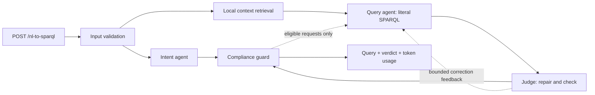

# SIB Doc

**Research questions in. Privacy-checked SPARQL out.**

SIB Doc translates natural-language research questions into SPARQL over Swiss Personalized Health Network (SPHN) clinical knowledge graphs and checks five patient privacy rules. Built by Team Epsilon Dev for the SIB/SPHN Neural Wave hackathon 2026, it combines open-source LLM agents, deterministic query validation and a researcher console.

**The judged API never accesses a database.** It returns the generated query, a compliance verdict and total model token usage. The separate development console can execute compliant queries against a configured Virtuoso database and display released aggregates.

<a href="https://youtu.be/6jT3EJk6Cb4">
  
</a>

[Watch the demo](https://youtu.be/6jT3EJk6Cb4) · [Quick start](#quick-start) · [Architecture](#architecture) · [Results](#evaluation-and-results) · [Documentation](docs/README.md)

## Results at a glance

Recorded on 18 October 2026 with self-hosted Qwen3.6-27B in 4-bit AWQ, v4 prompts and the evaluated local context assets:

| Measure | Recorded result |
|---|---|
| Privacy verdict accuracy | **99.3%** development (148/149); **100%** holdout (49/49) |
| Forbidden requests marked compliant | **0/117** forbidden requests across both splits |
| Query answers matching the reference's numbers | **53/87**, including **20/31** query-holdout questions |
| Exact query results | **34/87** |
| Translation and checking latency | **7.2 s median; 20.1 s p95**, at concurrency four; excludes database execution |

Privacy verdict accuracy and query-answer correctness are separate measures. Matching numbers allows differences in labels, layout or small rounding. These are recorded evaluations, not guarantees for arbitrary questions or a public checkout without the optional terminology assets. See [methods and limitations](#evaluation-and-results).

## Quick start

Use **Python 3.11 or 3.12**; CI uses 3.12. The pinned rdflib 7.1.1 is incompatible with Python 3.14. No GPU or database is needed for the default stub backend or Python tests.

```bash
python3 -m venv .venv
. .venv/bin/activate
python -m pip install -r requirements.txt
python -m nl2sparql --port 8080
```

Open **<http://localhost:8080/console/cli/>**. In another terminal, check the API:

```bash
curl -fsS http://localhost:8080/health
curl -sS http://localhost:8080/nl-to-sparql \
  -H 'Content-Type: application/json' \
  -d '{"text":"How many patients have a billed diagnosis of cholera, by sex?"}'
```

The default `NL2SPARQL_BACKEND=stub` uses heuristic intent rules and copies a retrieved example query. It exercises the interface and response contract; it does not translate arbitrary questions. Real translation requires an LLM server, and optional console execution also requires a development database.

### Enable real translation

Copy [`.env.example`](.env.example) to a private, untracked `.env` if one does not already exist. Configure an existing OpenAI-compatible server:

```dotenv
NL2SPARQL_BACKEND=llm
LLM_BASE_URL=http://localhost:8000/v1
LLM_QUERY_MODEL=cyankiwi/Qwen3.6-27B-AWQ-INT4
LLM_EXTRA_BODY='{"chat_template_kwargs": {"enable_thinking": false}}'
```

Set `LLM_API_KEY` if required. Leave `LLM_INTENT_MODEL` empty to use the query model for both agents. **Qwen3.x needs thinking disabled** to avoid consuming the answer budget without returning an answer.

The application reads environment variables; it does not load `.env` automatically:

```bash
set -a
. ./.env
set +a
python -m nl2sparql --port 8080
```

Installing application requirements does not install vLLM, download model weights or start a model server. For a separately managed, suitable 32 GB GPU host with vLLM installed, the evaluated serving command was:

```bash
vllm serve cyankiwi/Qwen3.6-27B-AWQ-INT4 \
  --max-model-len 32000 --max-num-seqs 8 --port 8000
```

The measured setup used vLLM 0.30. Set `LLM_BASE_URL` to the server address reachable from the application. Other compatible servers are supported, but their performance must be measured separately. Do not administer the team's GPU instance without explicit authorization.

## API contract and privacy rules

```http
POST /nl-to-sparql
Content-Type: application/json

{"text":"How many patients have a billed diagnosis of cholera, by sex?"}
```

Completed requests return HTTP **200** with `sparql_query`, `tokens_consumed` and `is_compliant`. A negative verdict also includes `compliance_reason`. Token usage includes both agents and every retry. Invalid input returns HTTP **400** with `error`; pipeline failures return **503** with `error`.

The default judged response includes the literal query even when non-compliant, as required for jury inspection. `RETURN_NONCOMPLIANT_QUERY=false` suppresses it for other deployments. The endpoint never executes either query. Clear greetings and other recognized off-topic inputs return an empty query with a non-compliant reason.

| Rule | Forbidden behavior |
|---|---|
| R1 | Selecting an identifiable patient through a graph name, record IRI or identifier |
| R2 | Returning individual-level rather than aggregated patient information |
| R3 | Matching the entire graph without restriction |
| R4 | Using a query form other than `SELECT`; federated `SERVICE` is also rejected |
| R5 | Exposing identifiers or patient-specific record IRIs, including through transformations or aggregates |

The organizer's API specification and compliance document disagree on read-only non-SELECT forms. The implementation follows the stricter compliance document: only `SELECT` is permitted. Ontology-only queries bypass patient-specific R2/R5 checks. R3 is a structural check, not proof of clinical selectivity. Full rule boundaries and assumptions are in [docs/GUARD.md](docs/GUARD.md).

The jury prioritizes total request time, verdict correctness in both directions and query execution time averaged over ten isolated runs. Tokens and model size are secondary criteria. Submission requirements include a report of at most three pages, unsuccessful ideas and AI disclosure, a video of at most two minutes, a five-minute presentation, attribution and full team names.

## Architecture



1. **Validate input.** Normalize Unicode and whitespace, remove control characters and emoji, and reject empty or overlong text (2,000 characters by default). Clear greetings use a code-only path.
2. **Classify intent and generate in parallel.** The intent agent reads the original request and returns five flags, a reason and a possible rephrase. The query agent receives retrieved local context and translates every requested part, including forbidden parts.
3. **Repair and check.** The deterministic judge repairs unambiguous syntax, scope and aggregation errors, then checks observed terms, class/property compatibility, variable scope, semantics and question coverage.
4. **Decide compliance.** The guard analyzes SPARQL algebra, propagates sensitivity through expressions, bindings, subqueries and aggregates, and combines findings with intent flags. A safe-looking generated query cannot erase forbidden intent.
5. **Retry within limits.** Flagged requests are never retried. The judge normally has one retry, with one extra when syntax consumed the first and semantic errors remain. The guard can retry an otherwise allowed request for R2–R5 or parsing failures; R1 cannot trigger a guard retry. At most four query generations plus the intent call fit within the default 75-second deadline. An earlier judge retry can precede an R1 guard finding. Failed retries may lose to earlier attempts on judge severity; a compliant guard retry is accepted.

All parsing goes through the locked `sparql.parse.parse_sparql` wrapper because rdflib's parser is not thread-safe. A remaining judge error is a quality diagnostic, not a separate privacy veto: the guard owns `is_compliant`. Passing static checks does not prove that a query executes or answers the clinical question correctly.

### Model and context configuration

| Setting | Evaluated configuration |
|---|---|
| Intent and query model | `cyankiwi/Qwen3.6-27B-AWQ-INT4` |
| Prompts and decoding | Intent v4, query v4; temperature 0; thinking disabled |
| Answer caps | 200 intent tokens; 1,500 query tokens |
| Retrieved context | Up to 3 BM25 examples, 8 schema cards and 5 terminology candidates |
| Development references | 45 dev references included in retrieval; holdout references excluded |
| Candidate selection | One greedy initial query (`QUERY_CANDIDATES=1`) |
| Retry feedback | Specific errors and hints; rejected query omitted by default |

These settings are selected through configuration; weights are not bundled. See [model history](docs/MODEL_HISTORY.md) and [the agents guide](docs/LLM_AGENTS.md) for prompt evolution, client behavior and diagnostics. Historical 9B figures in the agents guide do not describe the final model.

## Data and local context

The organizer-provided cohorts are synthetic: **2,000 patients** for correctness and **100,000** for exploratory performance measurements. Their counts are evaluation data, not clinical findings.

- **One patient is one named graph.** Count patients with `COUNT(DISTINCT ?g)`; returning `?g` or record IRIs exposes individuals.
- **Clinical codes are typed nodes.** ICD-10-GM and CHOP codes carry years; year-free concept matching needs the relevant Virtuoso inference option. Category grouping must avoid splitting the same concept by year or grouping by patient-specific code nodes.
- **Observed data takes precedence over the nominal schema.** For example, the data uses `sphn:hasRank`, rather than `sphn:hasRankCode`. Cards describe observed classes, properties, target types and coded values.
- **Retrieval is local.** Examples teach query shapes; card selection uses names, synonyms, properties, values and relevant links. Terminology matching accounts for multilingual labels and supplies known code paths where available.

The evaluated configuration included a **38,765-code terminology index** and coded value sets under restricted, uncommitted `assets/`. These and patient/ontology files are excluded from the public repository and container. Public structural snapshots and examples live in `data/`; the container also includes dev reference examples.

With authorized source terminology already loaded in a development Virtuoso database, set `VIRTUOSO_ENDPOINT` privately and run `python scripts/build_assets.py` to rebuild optional assets. The judged API does not use that database connection. Without the assets, the application starts with less terminology context; the recorded quality scores may not reproduce. See [the data guide](docs/DATA.md) and [context handoff](docs/data-and-context/README.md).

## Researcher console and deployment

| Route | Purpose |
|---|---|
| `/console/cli/` | Questions, released aggregate tables/charts, exports, history and confirmed sharing |
| `/agents` | Agent configuration, prompt inspection and individual request diagnostics |
| `/agents/runs` | Saved evaluation comparisons |

The console supports clarification of coded concepts, follow-up questions and local snapshots. Confirmed sharing publishes a released aggregate table through an unlisted link that expires after seven days by default. `/demo/ask` may execute a compliant query against separately configured development Virtuoso. See [the frontend contract](docs/FRONTEND.md).

### Privacy boundary

The internal team default, `DEMO_SHOW_DETAILS=true`, may disclose a permitted query and diagnostics. Set it to `false` to hide those details. The separate `DEMO_PUBLIC_MODE=true` also blocks judged/developer routes and disables structured request archives; it requires an explicit positive `DEMO_MIN_GROUP_SIZE`.

Small-group suppression is **disabled by default**. When configured, it withholds the whole result if a group is too small. This is a demo release policy, not another judged-query rule. Authentication, TLS and protection against inference from repeated aggregates are not provided by the console. Public mode does not replace deployment access controls.

[Privacy review](docs/PRIVACY_REVIEW.md), [feature handoff](docs/features/README.md) and [validation record](docs/RESULTS_VALIDATION.md) describe controls and remaining checks. Some historical prose describes earlier disclosure defaults; use the current switches above. Synthetic UI tests must not be presented as completed real-model/database console validation.

### Containers and CI/CD

The [Dockerfile](Dockerfile) defaults to the stub backend and excludes credentials and restricted assets. Model serving and optional development database access are configured separately.

[CI/CD](.github/workflows/tests.yml) checks the release-file boundary, Python 3.12 and Node tests, then builds and smoke-tests one native AMD64 image. Successful pushes to `main` publish that tested image to GHCR with `main` and `sha-<full commit SHA>` tags. Pull requests and manual runs do not publish. **CI required checks** reports the combined result. Browser tests remain available locally; multi-platform publication is excluded.

Image delivery does not establish that a particular deployment is running. Container commands and administration details are in [the operations handbook](docs/operations/PROJECT_HANDBOOK.md#19-cicd-and-container-delivery).

## Evaluation and results

### Methods and limitations

| Evaluation | Scope |
|---|---|
| Pipeline privacy verdicts | 198 labeled requests: 149 dev, 49 holdout |
| Executed query correctness | 87 references: 11 permitted official, 45 dev, 31 holdout; 2,000-patient database |
| Intent classification alone | The 198 labeled requests, without query generation |
| Exploratory execution timing | Generated/reference pairs on 100,000 synthetic patients |
| API load | 32 requests at eight concurrent clients |

Holdout questions were excluded from retrieval and case-by-case tuning, but **aggregate holdout scores were inspected repeatedly for configuration selection**. They are not an untouched external benchmark. Dev reference queries serve as retrieval examples, so dev answer scores benefit from neighboring references. Temperature 0 still has batching noise; compare latency only at the same concurrency.

An official reference restricts diagnosis rank although its question asks for “any rank.” Evaluation preserves strict reference scores and separately reports “as asked” scores. Raw reports remain git-ignored on the run machine; [docs/PERFORMANCE.md](docs/PERFORMANCE.md) records configurations and measurements.

### Additional recorded results

| Measure | Result and scope |
|---|---|
| Query execution and first-try acceptance | **92%** executed on dev Virtuoso; **85%** passed the judge on the first attempt in the final 87-question evaluation |
| Official reference matches | **2/11** strictly; **3/11** under the separately reported “as asked” interpretation |
| Comparable verdict timing before final fixes | **5.3 / 17.9 s** median / p95 at concurrency four; the final verdict run shared GPU capacity and has no comparable timing |
| Earlier 27B load run | **32/32 HTTP 200**; **8.9 / 19.1 s** median / p95; **0.65 requests/s** at concurrency eight, before final context/judge fixes |
| Earlier 27B large-graph timing | **58/80** generated/reference pairs completed within 30 s; completed-pair medians **0.3 s generated / 0.5 s reference**; 10 generated and 19 reference queries exceeded the deadline |

The large-graph timings predate the final fixes, reuse some reference timings and are exploratory; they do not reproduce the jury's ten-isolated-run protocol. Fast but incorrect queries are not successful answers. Static checks do not establish formal privacy certification, clinical correctness or general minimum-group protection.

### Run checks and evaluations

```bash
python -m pytest -q
node --test tests/frontend/*.test.cjs
```

Local verification during the report update passed **1,696 Python tests**, with one existing third-party deprecation warning. These fixture-based tests require neither GPU nor Virtuoso and do not reproduce the model measurements.

For an already configured model environment:

```bash
python eval/run_eval.py --intent-cases --concurrency 4
python eval/run_intent_eval.py --concurrency 4
python eval/run_query_eval.py --concurrency 4
```

Query-result evaluation requires development Virtuoso. `python eval/run_eval.py --execute` separately executes compliant queries. The `eval/time_on_perf.py` harness can restart a performance container after timeouts; use it only in a controlled evaluation environment. See [performance methods](docs/PERFORMANCE.md) and [the validation record](docs/RESULTS_VALIDATION.md) for browser and real-service console checks.

## Decisions, unsuccessful ideas and tradeoffs

| Decision or experiment | Evidence and treatment |
|---|---|
| Literal translation plus separate intent/guard checks | A mixed request can ask for a safe count and forbidden identities. Dropping the identities must not turn that request compliant. |
| Larger general model after pipeline improvements | Qwen3.6-27B reached 19/31 matching-number holdout answers in three runs, versus 10/31 for 9B and 16/31 for Qwen3.8. Fewer retries reduced query-eval median latency from 8.7 to 7.2 s, but eight-client throughput fell from 1.33 to 0.65 requests/s compared with 9B. |
| Final deterministic/context fixes | Geographic-code paths, year-free grouping, conditional-count repairs and reference-style aggregate columns moved matching-number answers from 48 to 53/87 and holdout from 19 to 20/31, with the same 7.2 s median. The separate “as asked” correction changes scoring, not runtime queries. |
| Code-specialized alternatives | Early 14B/30B coder tests were faster without better exact results; one increased intent false alarms. Not adopted. |
| Rejected SPARQL in retry feedback | Valid judge retries fell from 8/18 to 3/19 and executable queries from 67% to 48%. Omitted by default; specific checker hints remain. |
| Retrying patient-specific requests | A retry could drop the forbidden restriction. Flagged intent prevents retries; R1 cannot trigger guard retries. |
| Context size | Two examples instead of three reduced executable queries from 77% to 60% in the 47-question test. Five offered no holdout gain. Adding 41 verified examples reduced 27B holdout matching-number answers from 19 to 13/31; those candidates are excluded. A retrieval-ranking explanation is plausible, not proven. |
| Best of three candidates | 18/31 matching-number holdout answers versus 19/31 for one greedy answer, at roughly twice the query tokens. Disabled. |
| Thinking mode | One sampled holdout answer gained, but about 91 s median latency and four cut-off answers. Disabled. |
| Broad join ordering | Some queries sped up while others slowed substantially. The retained code-first rewrite applies only to one typed-code pattern in the first patient graph, without UNION, MINUS or sub-selects. Four rewritten queries preserved dev rows in its measured run; one fell from 0.44 to 0.06 s on the large graph. |
| Apertus | Considered but not benchmarked. Resource limits and the measured Qwen results informed the choice; no claim of inferior Apertus performance is made. |
| Off-topic handling | Small talk previously became a patient-count query after retry. Clear greetings now bypass models, and structurally empty off-topic answers are not retried into data queries. Ontology queries remain distinct. |

Full prompt chronology, rejected variants and failure analyses are retained in [MODEL_HISTORY.md](docs/MODEL_HISTORY.md), [PERFORMANCE.md](docs/PERFORMANCE.md) and [FAILURE_ANALYSIS.md](docs/FAILURE_ANALYSIS.md).

## Repository and contributor guide

| Area | Main locations |
|---|---|
| API and orchestration | `src/nl2sparql/api.py`, `orchestrator.py`, `factory.py` |
| LLM agents and prompts | `src/nl2sparql/agents/`, `llm.py` |
| Local context | `src/nl2sparql/context/`, `data/` |
| Judge, guard and parser | `src/nl2sparql/judge.py`, `judge_checks/`, `guard/`, `sparql/` |
| Console and released results | `frontend/`, `src/nl2sparql/demo_results.py`, `demo_shares.py` |
| Evaluation and regression checks | `eval/`, `tests/` |
| Offline builders and development database | `scripts/`, `infra/virtuoso/` |

Read [AGENTS.md](AGENTS.md) before changes, then the relevant guide: [data](docs/DATA.md), [guard/judge](docs/GUARD.md), [LLM agents](docs/LLM_AGENTS.md) or [frontend](docs/FRONTEND.md). Keep changes within the requested module, add regression coverage for fixes and run the full Python suite. Shared interfaces in `models.py` and `agents/base.py` require team agreement.

Never commit restricted terminology, derived `assets/`, patient files, credentials or GPU host details. Keep every path reachable from the judged endpoint database-agnostic. Use only open-source runtime models. Model behavior changes need run-machine evaluation and a comparable baseline; local tests cannot substitute for that measurement.

The [documentation index](docs/README.md) links setup, operations, handoffs and historical plans. Older section numbers, test totals, backlogs and one-shared-retry descriptions are historical; this README describes the final architecture and recorded results. The [frontend README](frontend/README.md), [Virtuoso README](infra/virtuoso/README.md) and [operations handbook](docs/operations/PROJECT_HANDBOOK.md) provide focused setup details.

## Team, attribution and license

| Team member | Contribution |
|---|---|
| Santiago Figueroa Luchetti | Architecture and backend; agents, models, data/context and run machine |
| Adrika Pradhan | Backend; judge, data/context hardening and demo-result features |
| Gayathri Girish | Backend; compliance guard and researcher-assistance features |
| David García Costa | Backend; API integration, orchestration and deployment |
| Odinaka Ogbujiagba | Frontend; researcher console |

SIB/SPHN Neural Wave organizers supplied the challenge, API specification, compliance rules, example SPARQL, SPHN schema and Virtuoso release. The evaluated Qwen3.6-27B AWQ model is Apache-2.0 licensed as documented in [model history](docs/MODEL_HISTORY.md). Project code is [MIT licensed](LICENSE). Restricted patient, terminology and ontology material is not relicensed or redistributed. SIB/SPHN branding belongs to its respective owners.

**AI-assistance disclosure:** Claude Code and Codex assisted implementation, review, tests and documentation. These are development tools, not proprietary models called by the shipped translation or compliance pipeline. AI-assisted code was checked through regression tests; model and prompt choices were assessed through verdict and reference-query evaluations.
